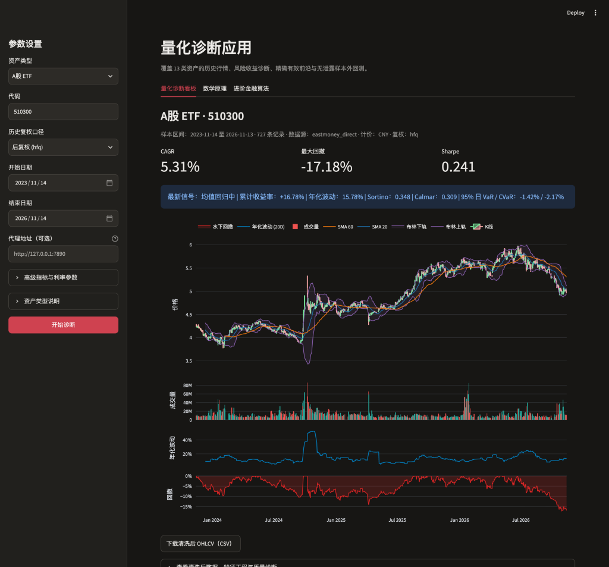
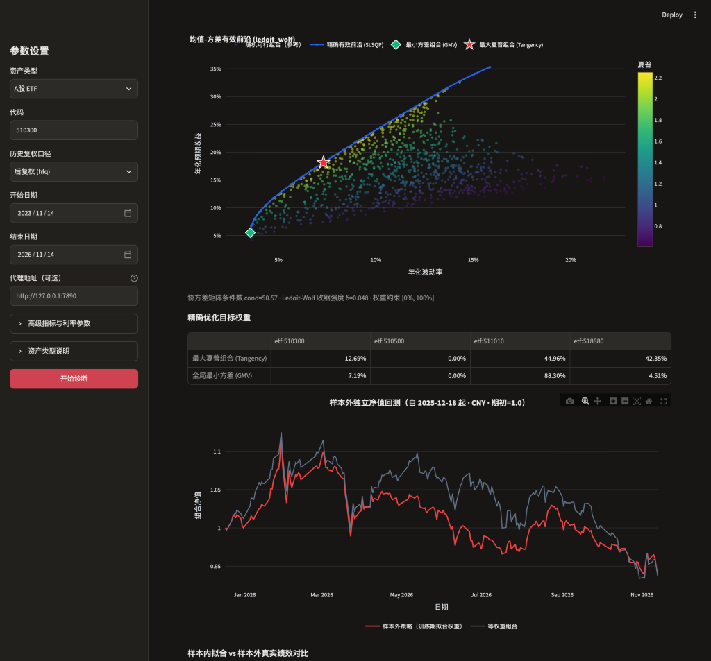
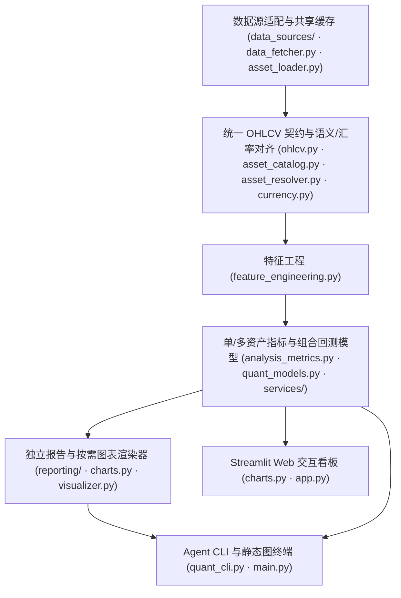

# Quantitative Analysis

**Python 多资产金融数据分析与可视化工具**（仅维护 Python 3.14.x）。

项目围绕统一的 **OHLCV（开高低收量）** 数据契约，整合跨市场行情检索、数据清洗与质量诊断、技术特征工程、风险收益统计指标、精确有效前沿优化及无前视偏差样本外回测。现已完成 **M0–M7** 全部阶段演进，通过 **模块化 Streamlit Web 分析平台（`app.py` + `ui/`）** 与 **Python 命令行（`quant` Agent CLI / `quantitative-analysis`）** 提供统一计算口径、交互可视化与结构化报告能力。

> 本文严格对照当前源码说明已实现能力；工程架构与阶段演进记录请参阅 [工程架构](docs/ARCHITECTURE.md) 与 [产品定位与开发路线图](docs/ROADMAP.md)。

---

## 核心能力概览（V1.0 已实现）

- **多资产数据获取与统一处理**：支持 13 类跨市场资产元数据与行情路由、跨市场交易日历对齐（`common_trading_dates` / `weekly_friday` / `mtm_outer`）、基准货币折算（`CNY` / `USD` / `LOCAL`）与 Web/CLI 共享 Parquet 磁盘缓存。
- **OHLCV 清洗、校验与特征工程**：标准化六列 OHLCV 契约（无时区升序唯一日期索引），输出 9 项质量诊断计数，并计算 SMA、EMA、布林带、RSI(14)、MACD、对数收益滚动波动率及回撤序列。
- **风险收益统计与组合模型**：计算累计收益、CAGR、年化波动率、最大回撤、Sharpe / Sortino / Calmar 与 95% 日 VaR / CVaR；支持分布正态性检验（Jarque-Bera）、Memmel 夏普差异检验、Ledoit-Wolf 协方差收缩、SciPy SLSQP 精确有效前沿（GMV 与切点最大夏普）、Euler 风险贡献、GBM 蒙特卡洛模拟及 Train/Test 与 Walk-Forward 样本外回测。
- **Web 统一平台（M5–M7）与交互导出**：模块化拆分的 [app.py](app.py) 与 [ui/](ui/) 全面对接 `analyze_single_asset`、`compare_assets`、`analyze_portfolio`、`build_plotly_figures` 与 `reporting/` 渲染器，围绕 **单资产探索 / 多资产比较 / 投资组合研究** 三个核心工作区组织界面，支持 `auto` / 深色终端 / 浅色研报主题切换、标签页图表浏览（含 `1M–全部` 区间快捷按钮与十字准星悬停）、五类故障分类提示、版本化状态与导出缓存失效以及 Markdown / 自包含 HTML 研究报告、strict JSON 与 UTF-8 BOM CSV 一键预览和导出，确保相同数据快照与参数下 Web 与 CLI 输出严格一致。
- **Agent CLI 与标准化输出（`quant`）**：提供面向 AI Agent 自动化调用的 `quant fetch`、`quant analyze`、`quant compare` 与 `quant portfolio` 命令，支持全 13 类资产检索、跨市场日历与汇率对齐、多资产统计比较、组合优化（SLSQP 精确有效前沿、`min_variance`/`max_sharpe`/`risk_parity`/`inverse_volatility`/`equal_weight`/`custom`）与严格无前视偏差样本外回测，事务性原子输出版本化 `result.json`（含指标、权重、风险贡献、模型假设、数据质量与警告）及类型化 Parquet 产物；`stdout` 严格输出 JSON，`stderr` 输出日志与结构化错误，附稳定退出码（`0`/`2`/`3`/`4`/`5`/`1`）；默认不加载绘图库，按需通过 `--report` / `--charts` / `--chart-types` 生成可阅读报告与图表。
- **独立报告与图表渲染（M4 `reporting/`）**：支持按需生成结构化 `Markdown`（`report.md`）与离线自包含 `HTML`（`report.html`）研究报告及多格式图表（交互式自包含 Plotly `html` 与 Matplotlib/`mplfinance` 静态 `png`/`svg`，输出至 `<output>/charts/`），严格遵循计算与渲染分离契约（仅消费 `AnalysisResult`/`MultiAssetResult` 或磁盘 `result.json` + Parquet，不重复抓取数据或重算指标），并在展示层显式区分历史实现统计、统计假设检验、样本内前视参考、样本外因果回测与蒙特卡洛/Dirichlet 模拟，统一以非正百分比（`<= 0%`）展示水下回撤并正确处理 `yield_level_not_return` 等阻断指标。
- **既有终端与 Web 入口兼容**：保留 `python main.py` / `quantitative-analysis` 终端报告、`mplfinance` 静态图表导出与 Streamlit Web 看板完整可用。

---

## 分析看板实景展示

以下截图均在本地实际运行 `streamlit run app.py` 并拉取真实公开行情数据截取（仅作工具计算与界面展示，不构成投资建议）：



*图 1：单资产「量化诊断看板」实景（标的：A股 ETF `510300`，区间 `2023-11-14` 至 `2026-11-13`，727 条后复权日线记录，数据源 `eastmoney_direct`），展示核心风险收益指标、布林带信号摘要、K 线/均线/成交量/滚动波动率/水下回撤四联图与 CSV 导出入口。*

---

## 主要技术栈

| 类别 | 主要技术与库 |
| --- | --- |
| 运行环境 | Python `>=3.14,<3.15`（仅维护 3.14.x；本地验证环境 3.14.5） |
| 数据处理与契约 | `pandas`、`NumPy`、`PyArrow`（`<26`） |
| 统计与优化算法 | `SciPy`（SLSQP 精确有效前沿）、内置解析 Ledoit-Wolf 收缩与风险指标计算 |
| 可视化与界面 | `Streamlit`（`>=1.50`）、`Plotly`、`Matplotlib`、`mplfinance` |
| 外部行情与网络 | `AKShare`、`CCXT`、`requests`、`httpx` |
| 测试与代码规范 | `pytest`、`Ruff` |

---

## 快速运行

### 1. 环境准备

```bash
git clone https://github.com/Ultramarine-1011/Quantitative_Analysis.git
cd Quantitative_Analysis
python -m venv .venv
source .venv/bin/activate        # Windows PowerShell: .\.venv\Scripts\Activate.ps1
pip install -r requirements.txt
```

### 2. 启动 Streamlit Web 应用

```bash
streamlit run app.py
# Windows 亦可使用仓库脚本：streamlit.bat run app.py
```

在左侧 **「全局与单资产参数设置」** 选择日期范围、无风险利率与代理，配置单资产代码并点击 **「🔍 运行单资产分析」**，随后可在顶部三个核心工作区之间自由切换：

- **📈 单资产探索**：单资产绩效指标、数据质量诊断、交互式 K 线/均线/布林带/波动率/回撤图、折叠式数学原理参考、归一化净值与 GBM 蒙特卡洛探索，以及 Markdown/HTML 报告和 JSON/CSV 导出。
- **⚖️ 多资产比较**：跨市场日历对齐与统一币种折算（默认 `CNY`）、历史收益对比、Jarque-Bera 正态性与 Memmel 夏普检验、相对基准分析、相关性/滚动检验与多维报告导出。
- **🎯 投资组合研究**：6 类组合配置策略（含 `custom` 自定义权重与 SLSQP 精确有效前沿）、Euler 风险贡献、Train/Test 与因果 Walk-Forward 样本外回测（含 `in_sample` 前视偏差警告）、敏感性分析矩阵与完整研究报告导出。

### 3. 运行 Agent CLI（`quant`）与原单资产终端（`quantitative-analysis`）

需要离线重算时，首次运行加 `--data-mode online --snapshot-dir ./inputs`，之后使用相同资产、复权和日期，传入 `--data-mode offline --snapshot-dir ./inputs --snapshot-id <清单SHA256>`。清单 ID 在 `data_summary.snapshot_id` 中。具体示例见[研究输入快照](docs/ARCHITECTURE.md#研究输入快照)。

安装可编辑包（`pip install -e .`）后即可直接调用 `quant` 与兼容命令 `quantitative-analysis`（源码目录内亦可使用 `python quant_cli.py`）：

```bash
# 查看 Agent CLI 帮助与子命令参数
quant --help
quant analyze --help
quant compare --help
quant portfolio --help

# 示例 1：检索并清洗数据，导出 result.json 与 data.parquet（不计算技术指标、不绘图）
quant fetch ashare:600519 --start 2024-01-01 --end 2026-11-13 --adjust qfq -o outputs/600519_raw

# 示例 2：执行单资产定量分析，指定口径与均线参数并落盘 result.json + data.parquet (+ 可选 CSV)
quant analyze -t etf -s 510300 --start 2024-01-01 --end 2026-11-13 --return-convention log --rf 0.016 --include-momentum -o outputs/510300 --csv

# 示例 3：静默进度日志、直接通过 stdout 读取结构化 JSON（退出码：0=成功/降级, 2=参数/校验错误, 3=空数据, 4=网络传输错误, 5=上游错误, 1=未预期异常）
quant analyze -t us_stock -s AAPL --start 2025-01-01 --end 2026-11-13 --quiet --compact

# 示例 4：多资产跨市场统一口径比较（CNY 计价、共同交易日对齐、相对基准指标、相关性/协方差与滚动统计）
quant compare etf:510300 us_stock:SPY gold:GC --benchmark etf:510500 --start 2024-01-01 --end 2026-11-13 --base-currency CNY --calendar-mode common_trading_dates --rolling-window 20 -o outputs/compare --csv

# 示例 5：投资组合优化、风险贡献、SLSQP 有效前沿与无前视偏差样本外回测（Train/Test 或 Walk-Forward）
quant portfolio etf:510300 etf:510500 etf:511010 etf:518880 --start 2023-01-01 --end 2026-11-13 --strategy risk_parity --validation-mode walk_forward_rolling --train-window 60 --rebalance-freq monthly --tx-bps 10 -o outputs/portfolio --csv

# 示例 6：按需生成 Markdown / HTML 研究报告与可视化图表（写入 <output>/report.* 与 <output>/charts/*.html|png|svg）
quant analyze us_stock:NVDA --start 2024-01-01 --end 2026-11-13 --include-momentum -o outputs/nvda_report --report all --charts html,png
quant portfolio etf:510300 us_stock:SPY --benchmark etf:510500 --start 2023-01-01 --end 2026-11-13 --base-currency CNY --strategy max_sharpe --validation-mode train_test -o outputs/port_report --report html --charts all --chart-types backtest,weights,frontier
```

> 注：为避免跨市场标的静默猜错，Agent CLI 对裸代码强制要求配合 `-t/--asset-type` 或显式 `TYPE:SYMBOL`（如 `ashare:600519`、`us_stock:AAPL`）。

兼容保留原有交互/静态图 CLI（`python main.py` / `quantitative-analysis`）：

```bash
# 查看原 CLI 完整参数帮助
python main.py --help

# 默认 A 股 ETF 510300（最近 3 年），输出终端诊断报告并无头导出静态图表与标准化 CSV
python main.py --asset-type ashare --symbol 600519 --start 2023-11-14 --end 2026-11-13 --save-chart outputs/600519.png --export-csv outputs/600519.csv --no-show
```

---

## 核心功能详解

### 1. 多资产数据获取与统一处理

- **13 类资产统一入口**：覆盖 A 股 ETF、A 股个股、公募基金、贵金属、加密货币（Binance via CCXT）、美股、港股、全球指数、中国国债 K 线、美债收益率水平序列、外盘商品期货、C-REITs 与外汇即期；支持多源回退、代码别名规范化与请求预算控制。
- **金融语义区分**：通过 `ASSET_RETURN_BASIS` 与 `ASSET_TRADING_DAYS`（加密 `365`、外汇 `260`、其余 `252`）区分复权价格、累计净值、期货连续合约、纯价格指数与收益率水平（如美债收益率水平序列禁止纳入净值组合优化）。
- **跨市场对齐与基准货币折算**：组合模块支持按共同交易日交集、周五周频或逐日盯市（附 `tradable_mask` 停牌隔离）对齐跨市场序列，并使用向后防前视偏差的 `merge_asof` 对齐汇率将数据折算为 `CNY`、`USD` 或保留 `LOCAL`（加密货币支持显式 USDT/USD 锚定开关）。
- **共享持久化缓存**：Web 与 CLI 共用基于 Parquet + JSON 元信息的磁盘缓存（默认 TTL 3600 秒，支持区间子集复用与一键强制刷新/`--refresh`），Web 端叠加 `@st.cache_data` 会话内加速。

<details>
<summary>展开查看：13 类资产参数示例与数据源说明</summary>

| 资产类型 key | 代码示例 | 口径与路由说明 |
| --- | --- | --- |
| `etf` | `510300` | A 股 ETF 日线（支持 `hfq` / `qfq` / 不复权，与个股区分） |
| `ashare` | `600519` | A 股个股日线（多源回退，支持 `hfq` / `qfq` / 不复权） |
| `mutual_fund` | `009691` | 公募基金累计净值序列（`Close` 为累计净值，无成交量） |
| `gold` | `GC`、`AU9999` | 外盘贵金属期货主力连续（`AU9999` 映射至 `GC`） |
| `crypto` | `BTC/USDT` | 现货日线（CCXT + Binance，支持侧边栏或 `--proxy` 指定代理） |
| `us_stock` | `AAPL` | 美股日线（支持 `qfq` / 不复权） |
| `hk_stock` | `00700` | 港股日线（纯数字自动补零至 5 位，支持 `hfq` / `qfq` / 不复权） |
| `global_index` | `.INX`、`HSI`、`SPX` | `.` 开头走新浪美股指数；简码映射东财国际指数 |
| `bond_cn` | `sh010107` | 沪深交易所债券日 K |
| `bond_us_yield` | `10Y` | 美债收益率水平序列（留空默认 `10Y`；非债券持有期回报） |
| `commodity` | `CL`、`HG` | 外盘大宗商品期货主力连续 |
| `creit` | `508097` | 基础设施公募 REITs 日线 |
| `fx` | `USDCNH` | 即期汇率日 K（亦支持 `USD/CNY` 等常见别名） |

> 注：所有外部行情依赖第三方公开接口（AKShare / 东方财富 / 新浪 / 腾讯 / CCXT），部分资产类型是否可用受上游接口变更、所安装 `akshare` 版本及网络访问条件影响。

</details>

### 2. OHLCV 清洗、校验与特征工程

- **统一契约**：强制校验并输出 `Open`、`High`、`Low`、`Close`、`Volume`（`float64`）与无时区、`ns` 精度、升序唯一的 `Date` 索引；`missing_policy="drop"` 剔除无效价格行且不对成交量前向填充。
- **质量诊断**：输出 9 项结构化计数（`dropped_invalid_rows`、`filled_price_rows`、`missing_volume_rows`、`zero_volume_rows`、`non_positive_price_rows`、`negative_volume_rows`、`ohlc_anomaly_rows`、`true_zero_return_rows`、`max_calendar_gap_days`），并在 Web 看板中给出明确提示。
- **特征计算**：单次校验后向量化计算短期/长期 SMA、对数收益滚动年化波动率、布林带上下轨、回撤序列以及可选 EMA、RSI(14) 与 MACD 柱状图，并透传 `DataFrame.attrs` 元信息。

### 3. 统计指标与多资产组合分析

- **单资产诊断指标**：区间累计收益率、自然日年化复合收益率（CAGR）、年化波动率、最大回撤、年化 Sharpe / Sortino / Calmar（默认无风险利率 1.6%，Web 端支持自定义）、95% 日 VaR / CVaR 以及最新布林带位置状态。
- **组合优化与样本外验证（「🎯 投资组合研究」）**：提供 6 类配置策略（`max_sharpe` / `min_variance` / `risk_parity` / `inverse_volatility` / `equal_weight` / `custom`）、Euler 风险贡献分解、多资产相关性热图、Ledoit-Wolf 协方差收缩估计、带权重上下界约束的 SciPy SLSQP 精确有效前沿（GMV 与 Tangency 最大夏普组合），以及 **Train/Test 静态划分**、**滚动/扩展 Walk-Forward 无前视偏差样本外回测** 与敏感性网格（支持再平衡频次与双边交易费率 bps）；`in_sample` 模式显式标注前视偏差警告。



*图 2：多资产组合有效前沿与样本外回测展示（预设「境内大类股债均衡」：`etf,510300` / `etf,510500` / `etf,511010` / `etf,518880`，`2023-11-14` 至 `2026-11-13`，726 个共同交易日，`CNY` 计价，Ledoit-Wolf `δ=0.048` + `Train/Test` 样本外独立回测），对比样本内前沿拟合权重与样本外真实净值走势。*

### 4. 交互式图表与统一报告导出

- **Web 端三核心工作区布局**：
  1. **📈 单资产探索**：对接 `analyze_single_asset`，提供核心 KPI、`yield_level` 语义阻断提示表、自适应主题 Plotly 图表、折叠式数学原理参考与归一化/GBM 高级探索，并与 CLI 共享图表与报告渲染契约。
  2. **⚖️ 多资产比较**：对接 `compare_assets`，涵盖跨市场日历/货币对齐、历史实现绩效与统计推断、相对基准表现及四联对比交互图表。
  3. **🎯 投资组合研究**：对接 `analyze_portfolio`，完整涵盖 6 类优化策略、Euler 风险贡献、精确前沿与可选随机可行域云图、Train/Test & Walk-Forward 回测及敏感性分析表，参数与结果按工作区独立隔离在 `st.session_state` 并支持 `@st.cache_data` 缓存及一键强制刷新。
- **标准化报告与数据导出**：三个工作区均通过 `reporting` 生成与 `quant` CLI 一致的 **Markdown（`.md`）预览与下载**、**离线自包含 HTML 报告（`.html`）**、**strict JSON 结果契约（`.json`）** 以及 **UTF-8 BOM 明细 CSV（`.csv`）**（含组合权重、回测序列与相关性矩阵附表）。

### 5. 当前 CLI 参数与分析流程

`python main.py`（或 `quantitative-analysis`）当前用于单资产端到端终端分析，主要参数如下：

- `--asset-type`：资产类型，支持全部 13 类 key（默认 `etf`）。
- `--symbol`：标的代码，缺省使用对应类别默认标的。
- `--start` / `--end`：`YYYY-MM-DD`，默认结束为今天、开始为结束日前推 3 年。
- `--adjust`：历史复权口径（`hfq` / `qfq` / `""`），按资产实际支持能力校验。
- `--base-currency`：可选单标的折算目标货币（`CNY` 或 `USD`）。
- `--proxy`：显式代理地址（如 `http://127.0.0.1:7890`）。
- `--save-chart` / `--export-csv` / `--no-show` / `--refresh`：静态图保存路径、CSV 导出路径、无头模式、忽略缓存强制刷新。

> 说明：`python main.py`（`quantitative-analysis`）定位为单资产终端报告与静态图导出兼容入口；多资产比较与投资组合研究请使用 `quant compare` / `quant portfolio` CLI、Streamlit Web 端 **「⚖️ 多资产比较」/「🎯 投资组合研究」** 工作区或 `services` / `quant_models` Python API。

---

## 系统架构

项目采用分层职责组织，数据经适配器与共享缓存加载后进入统一的 OHLCV 清洗与汇率/日历契约，再流向特征工程与统计/组合计算层，最终分别由 Streamlit Web 看板和 CLI 消费：



<details>
<summary>展开查看：核心模块清单与仓库目录结构</summary>

### 核心模块职责

| 模块 | 职责 |
| --- | --- |
| `app.py` / `ui/` / `charts.py` | M7 组件化重构后的 Streamlit 三工作区 Web 平台（门面入口 `app.py` + `ui/theme.py`、`ui/errors.py`、`ui/state.py`、`ui/components/`、`ui/workspaces/`）；主题自适应 Plotly 图表构建器（供 Web 与 `reporting` 共用） |
| `quant_cli.py` | V1.0 Agent CLI 入口（`quant fetch` / `quant analyze` / `quant compare` / `quant portfolio`），事务性多文件原子输出 `result.json` + Parquet + 按需报告/图表，附分级退出码 |
| `reporting/` | M4 独立渲染包（`report_renderer.py`、`chart_renderer.py`、`formatting.py`）：消费内存结果或磁盘 `result.json` + Parquet 生成 Markdown/HTML 报告及 HTML/PNG/SVG 图表，延迟加载绘图依赖 |
| `main.py` / `visualizer.py` | 原全 13 类资产命令行入口（`quantitative-analysis`）；基于 `mplfinance` 的静态多面板/纯折线图表渲染 |
| `asset_catalog.py` | 13 类资产 key、中文标签、默认标的、代码别名归一化、交易日年化因子、收益语义与复权支持矩阵 |
| `asset_loader.py` | 13 类资产统一入口 `load_asset_data`、并发加载与多市场交易日历对齐引擎 |
| `asset_resolver.py` | 日期窗口校验、境内权益加载与统一用户可读错误格式化（`china_equity_entry.py` 保留兼容重导出） |
| `currency.py` | 计价币种推断、向后防泄露 `merge_asof` FX 对齐与 `CNY`/`USD`/`LOCAL` 基准货币折算 |
| `data_fetcher.py` / `data_sources/` | 公共行情路由与底层适配器（境内回退、基金、东财、外汇）、请求预算、代理隔离与带覆盖回滚的 Parquet 共享缓存 |
| `ohlcv.py` | 六列 OHLCV 契约校验、缺失值策略（`raise`/`drop`/`ffill`）与 9 项质量诊断计数 |
| `feature_engineering.py` | `OHLCVFeatureEngineer`：SMA、布林带、EMA、RSI、MACD、对数收益波动率与最大回撤 |
| `analysis_metrics.py` | 单资产与多资产统计：累计收益、CAGR、年化波动率、Sharpe / Sortino / Calmar、VaR / CVaR、分布高阶矩/JB 正态检验、Memmel 夏普检验、相对基准与滚动统计 |
| `contracts.py` | 统一请求/序列元数据/质量报告/单资产与多资产结果契约（`AnalysisRequest`/`CompareRequest`/`PortfolioRequest`/`AnalysisResult`/`MultiAssetResult`） |
| `services/analysis_service.py` | 解耦于 UI/CLI 的单资产分析流水线服务（`fetch_single_asset` / `analyze_single_asset`） |
| `services/multi_asset_service.py` | 解耦于 UI/CLI 的多资产比较与组合研究服务（`compare_assets` / `analyze_portfolio`） |
| `quant_models.py` | GBM 模拟、相关性与协方差收缩、Euler 风险贡献、6 类组合策略优化、SLSQP 精确有效前沿与 Walk-Forward / Train-Test 样本外回测 |

### 目录结构

```text
Quantitative_Analysis/
├── app.py                  # Streamlit Web 兼容门面入口
├── ui/                     # M7 模块化前端主题、状态、错误分类、组件与工作区
│   ├── theme.py                # 自适应/深色/浅色设计系统与 Plotly 主题适配
│   ├── errors.py               # 五类交互错误分类器与提示格式化
│   ├── state.py                # 隔离工作区状态与版本化导出/图表缓存失效
│   ├── services_bridge.py      # 统一服务桥接、质量警告与预览解析
│   ├── components/             # 顶栏、侧边栏、告警、KPI、图表、表格与导出组件
│   └── workspaces/             # 单资产探索、多资产比较、投资组合研究工作区
├── quant_cli.py            # Agent CLI 入口（quant fetch / analyze / compare / portfolio）
├── main.py                 # 原交互/静态图 CLI 入口（quantitative-analysis）
├── asset_catalog.py        # 资产元数据、收益语义与预设组合
├── asset_loader.py         # 跨资产统一加载与多市场日历对齐
├── asset_resolver.py       # 窗口校验与境内权益路由封装
├── china_equity_entry.py   # 兼容重导出路径
├── currency.py             # FX 对齐与基准货币折算
├── data_fetcher.py         # 行情公共 API 与全球市场路由
├── contracts.py            # 统一数据契约（单/多资产 Request、SeriesMetadata、QualityReport、AnalysisResult、MultiAssetResult）
├── services/               # M1+ 无 UI 依赖的统一业务分析服务层
│   ├── analysis_service.py     # 解耦于 UI/CLI 的单资产分析服务
│   └── multi_asset_service.py  # 解耦于 UI/CLI 的多资产比较与组合研究服务
├── data_sources/           # 数据源适配器（含 crypto.py）、超时预算、代理策略与 Parquet 缓存
├── ohlcv.py                # 共用 OHLCV 清洗与质量诊断契约
├── feature_engineering.py  # 向量化技术特征与滚动统计
├── analysis_metrics.py     # 单资产诊断、分布检验、相对基准与滚动统计
├── quant_models.py         # 组合优化、Euler 风险贡献、SLSQP 前沿、GBM 与样本外回测
├── charts.py               # Plotly 交互图表
├── visualizer.py           # mplfinance 静态图表
├── reporting/              # M4 独立报告与图表渲染层
│   ├── formatting.py           # 金融口径格式化、阻断原因标签与磁盘契约反序列化
│   ├── chart_renderer.py       # 延迟导入的 Plotly HTML 与 Matplotlib/mplfinance PNG/SVG 渲染器
│   └── report_renderer.py      # 零绘图依赖的 Markdown / 自包含 HTML 研究报告渲染器
├── pyproject.toml          # 安装配置、CLI 注册与 Ruff / Mypy 配置
├── requirements.txt        # 运行依赖
├── streamlit.bat           # Windows Streamlit 启动包装脚本
├── .streamlit/config.toml  # Streamlit 默认服务配置
├── tests/                  # 离线自动化测试套件
└── docs/                   # 架构、审计、路线图与展示截图
```

更多关于当前计算口径边界（如单资产对数收益口径与组合简单收益口径差异）、历史兼容层与 M0 审计详情，请参阅 [工程架构文档](docs/ARCHITECTURE.md) 与 [M0 审计与契约文档](docs/M0_AUDIT_AND_CONTRACTS.md)。

</details>

---

## 产品方向与开发路线图

项目围绕两个互补的长期方向演进：

1. **面向用户的可视化分析平台**：提供统一且可解释的 Web 界面，支持单资产探索、多资产比较与投资组合研究，降低跨市场数据对齐、复权口径与样本外回测的使用门槛。
2. **面向 AI Agent 的金融数据处理与指标工具模块**：围绕 CLI-first 原则建设确定性、机器可读的数据获取与分析接口，使 Agent 无需手写脆弱爬虫或计算脚本即可取得标准化数据、质量检查与指标输出，进而结合外部文本信息进行推理。

### 实施状态与规划边界

| 能力状态 | 具体内容 |
| --- | --- |
| **当前已实现（M0–M7）** | 13 类资产适配、别名归一化与带覆盖回滚/锁保护的共享 Parquet 缓存；强类型契约 [contracts.py](contracts.py) 与无 UI 依赖服务 [services/](services/)（含 M6 研究输入快照离线重放与模型分层）；Agent CLI 完整提供 `quant fetch`、`quant analyze`、`quant compare`、`quant portfolio`；跨市场日历对齐与 FX 折算；高阶矩/JB 正态与 Memmel 夏普检验、相对基准、滚动统计、Euler 风险贡献、Ledoit-Wolf + SLSQP 精确有效前沿与样本外回测；**M4 独立报告与图表渲染器 [reporting/](reporting/)**；**M7 前端整体重构**（[app.py](app.py) 拆分为 [ui/](ui/) 可复用组件与三工作区，支持深浅双主题、状态/导出缓存精确失效、五类错误分类与 Plotly 终端图表升级）与 `main.py` 兼容 CLI |

详细设计原则、M0–M5 阶段验收标准与 V0.1–V1.0 迭代计划，请参阅 **[产品定位与开发路线图 (docs/ROADMAP.md)](docs/ROADMAP.md)**。

---

## 环境兼容性、网络与测试说明

### 环境与缓存配置

- **Python 与核心依赖**：仅支持 Python **3.14.x**（本地主验证环境为 **3.14.5**，CI 仅运行 **3.14**）。`pyproject.toml` 从 `requirements-core.txt` 安装核心依赖；`.[web]` 与 `.[charts]` 分别安装 Web 和图表依赖，`requirements.txt` 与 `.[dev]` 均包含完整渲染环境；Web 端要求 `streamlit>=1.50.0`（避免旧版前端与新版 Plotly 数组格式不兼容），`pyarrow` 保留 `<26.0.0` 约束。
- **共享磁盘缓存**：默认写入 `~/.cache/quantitative_analysis/ohlcv`，可通过环境变量控制：
  - `QUANT_CACHE_DIR`：自定义缓存目录。
  - `QUANT_CACHE_TTL`：缓存有效期（秒，默认 `3600`）。
  - `QUANT_DISABLE_CACHE=1`：禁用本地磁盘缓存。

### 网络与代理配置

- **加密货币接口**：在 Web 侧边栏 **「代理地址（可选）」** 或 CLI `--proxy` 传入（格式如 `http://127.0.0.1:7890`），仅由 CCXT 使用。
- **Windows 与系统代理策略**：导入库本身不会修改全局环境变量；入口启动或构造客户端时才应用策略。AKShare 等境内接口默认尝试直连；若需强制走系统/环境代理，请在启动前设置 `QUANT_USE_SYSTEM_PROXY=1` 并配置 `HTTP_PROXY` / `HTTPS_PROXY`。线程局部直连上下文不会删除进程环境变量，也不会干扰 CCXT 的显式代理。

### 自动化测试与静态检查

安装开发依赖后运行完整离线回归与规范检查：

```bash
python -m pip install -e ".[dev]"
MPLBACKEND=Agg QUANT_DISABLE_CACHE=1 python -m pytest -q
ruff check .
ruff format --check .
python -m pip check
```

- **离线测试范围**：`tests/`（配置见 `pytest.ini`）采用固定合成样本与模拟数据源，并通过 `tests/conftest.py` 强制拦截外网 DNS/Socket/HTTP 连接，覆盖 OHLCV 清洗与日期契约、数学指标、FX 防泄露折算、网络预算与代理策略、SLSQP 优化与 Walk-Forward OOS 回测、共享 Parquet 缓存并发、`quant` / `quantitative-analysis` CLI 与 Streamlit `AppTest`。
- **外部接口边界**：真实行情节点可用性、限流策略与上游接口字段变更无法由离线测试保证；相关手工验收与文档索引请见 [境内权益最小验证方案](docs/CHINA_EQUITY_VERIFICATION.md) 与 [历史前端验收记录](docs/FRONTEND_VERIFICATION.md)。

---

## 免责声明

本工具仅用于金融数据分析、工程实践与技术学习，不构成任何投资建议或收益承诺。行情与净值数据来自第三方公开接口，其准确性、完整性与时效性以数据源为准；各项统计指标、蒙特卡洛模拟及历史/样本外回测均为规则化历史计算结果，不代表未来市场表现，请勿作为实盘交易决策的唯一依据。
